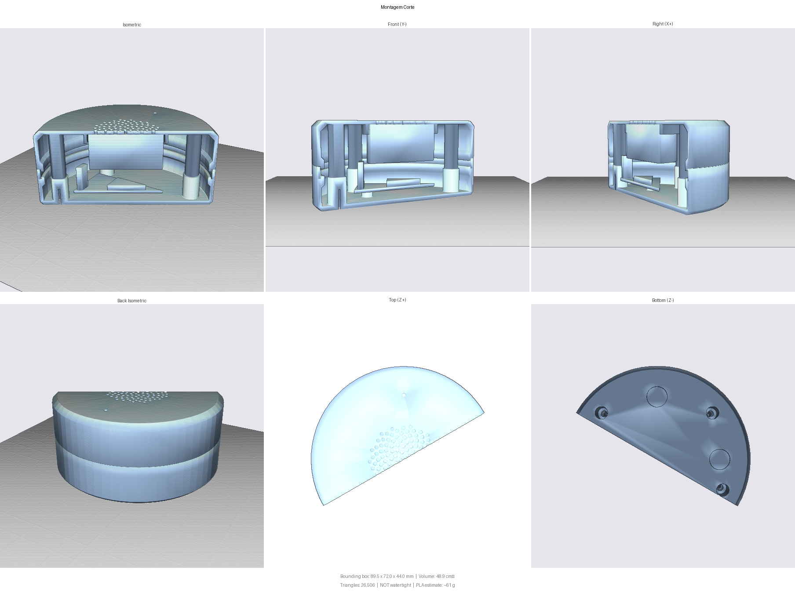

# Case do satélite (protótipo)

Puck redondo de 96 mm × 44 mm para a [placa-base do satélite](../satelite-base/README.md), um alto-falante redondo de 40 mm e o módulo INMP441. Modelo paramétrico em CadQuery: [`case.py`](case.py).

As posições de furo, USB-C, LED e botão no topo do `case.py` são espelho de `../satelite-base/index.circuit.tsx`. Mover um componente na PCB sem mover aqui gera case que não fecha.



## Encomenda

Suba `luna-satelite-case.zip` (gerado pelo `case.py`, com STL e STEP das quatro peças) no serviço de impressão. Unidade: **milímetros**. Quantidade: 1 de cada.

| Peça | Arquivo | Material e cor | Tamanho na mesa |
|---|---|---|---|
| Base | `base` | PLA ou PETG, cor escura fosca | 96 × 96 × 17,2 mm |
| Tampa | `tampa` | mesma da base | 96 × 96 × 28 mm |
| Botão | `botao` | mesma da base | 12,5 × 12,5 × 34,5 mm |
| Anel difusor | `anel` | PLA ou PETG **branco ou natural/translúcido** | 96 × 96 × 5,8 mm |

Configuração: FDM, camada de 0,2 mm, 3 paredes, 15% de infill, **sem suportes**. Os arquivos já estão na orientação de impressão — peça para não reorientar: a tampa imprime com a face da grelha na mesa e o botão com a cabeça na mesa.

A base tem tetos planos que saem como ponte, sem suporte: rebaixos dos pés (10,5 mm), rebaixos das cabeças dos parafusos (6,5 mm) e o teto do nicho do USB-C (15 mm entre duas paredes).

## Ferragens e peças compradas à parte

| Item | Qtd | Uso |
|---|---|---|
| Parafuso M3×12 cabeça cilíndrica ou panela (cabeça ≤ 6 mm) | 4 | fecha a case por baixo |
| Parafuso M3×6 | 2 | prende a PCB |
| Pé de borracha adesivo de 10 mm | 4 | rebaixos no fundo |
| Alto-falante redondo de 40 mm, até 20 mm de profundidade | 1 | colar da tampa |

Os parafusos abrem rosca direto no plástico (furo-piloto de 2,6 mm); aperte sem forçar.

## Montagem

1. Prenda a PCB na base com os dois M3×6, USB-C virado para o nicho.
2. Pressione o alto-falante no colar da tampa, cone virado para a grelha. Se ficar solto, fixe com cola quente.
3. Cole o INMP441 no berço da frente da tampa, com o furo acústico sobre o furo de 2 mm.
4. Solte o botão dentro da guia da tampa (haste para dentro).
5. Assente o anel na base, encaixe a tampa (o padrão de parafusos só casa em uma posição) e feche com os quatro M3×12 por baixo.

## Limitações conhecidas

- **Boca do USB-C** assumida rente à borda da PCB. Sobram ~1,4 mm entre o fundo do nicho e a placa; se o conector ficar recuado, o plugue encaixa pouco.
- **Anel de luz desigual:** o LED único fica junto ao USB-C, então o anel brilha mais atrás.
- **RESET e BOOT sem acesso externo:** ficam sob o alto-falante. A gravação por USB nativa não depende deles; para usá-los, abra a case.
- **Botão atrás, à direita:** segue a posição do SW3 na placa.
- Medidas do alto-falante e do INMP441 vêm de valores típicos, não de peças medidas.

## Regenerar

Python 3.12 (o CadQuery não tem wheel para 3.13+):

```bash
py -3.12 -m venv .venv
```

```bash
.venv\Scripts\python -m pip install cadquery trimesh
```

```bash
.venv\Scripts\python case.py
```

```bash
.venv\Scripts\python check_print.py
```

`case.py` escreve `stl/`, `step/`, o zip e o corte de conferência, e acusa colisão entre as peças e uma maquete da eletrônica. `check_print.py` confere malha fechada e balanços acima de 45°.
